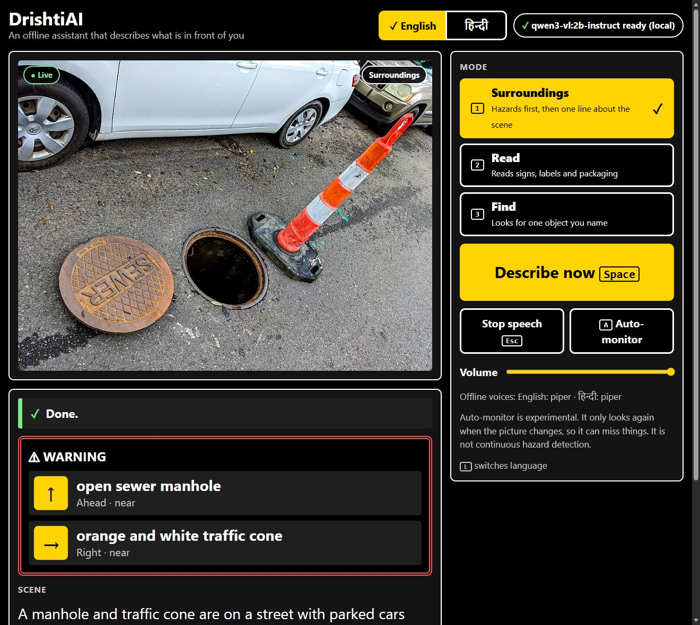
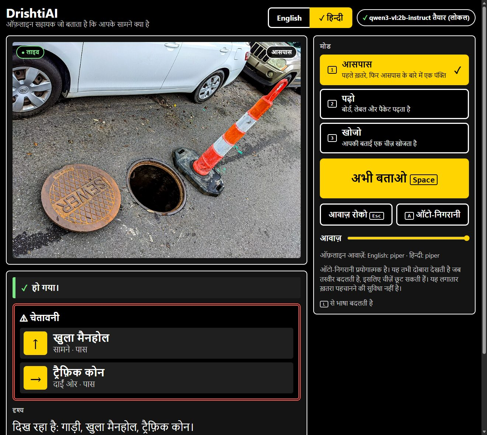
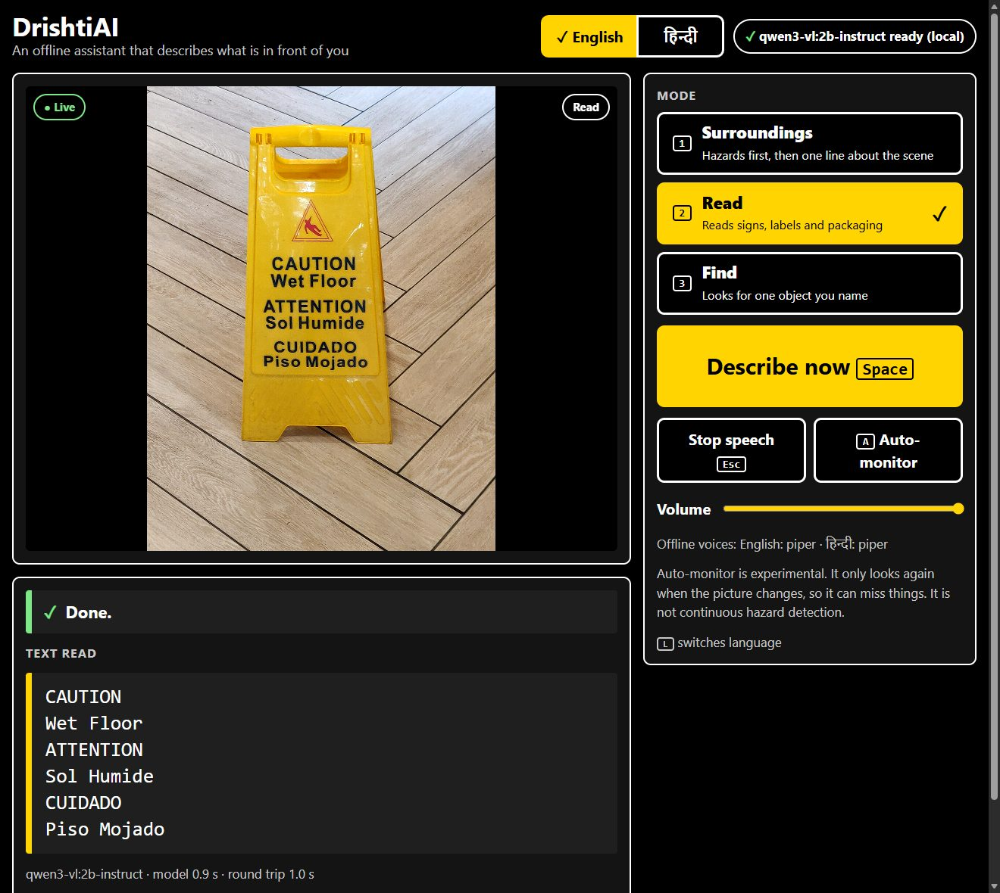
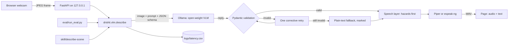

# DrishtiAI

An offline assistant that tells a blind or low-vision person what is in front of them.
A webcam frame goes to an open-weight vision-language model running on your own machine;
the answer comes back as validated JSON and is spoken aloud, **hazards first**, in English
or Hindi. No image, text or audio leaves the computer.

Built solo at Hacktoberfest Hack Day Hamirpur x ISTE NITH on 11 October 2026, for the
Best Open-Source AI Project track. *Drishti* (दृष्टि) is Hindi for sight.

> **Read this first.** DrishtiAI is an experimental aid. It can be wrong and it can miss
> hazards. It does not replace a cane, a guide dog or a human guide.

## 1. What it does

- **Surroundings**: describes the scene, warning about physical hazards before anything else.
- **Read**: reads visible text such as signs, labels and packaging.
- **Find**: you name an object; it answers found, not found or uncertain, with a rough location.
  For about 50 everyday things (a bottle, a cup, a phone, a bag, a chair, a laptop) it
  guides you live instead, as you turn the camera: "Bottle on the left, mid distance" ...
  "Bottle ahead, near. It is right in front of you."
- **Money**: says which Indian rupee notes or coins it sees and adds up the total.
- **Walk mode**: a few times a second, a fast object detector warns about people,
  vehicles and animals that are close or straight ahead, without waiting for the slower
  model.
- Speaks the answer with an offline voice, in English or Hindi.
- Works from the keyboard alone, or by voice alone: say "describe", "read",
  "find my bottle" or "how much money". Speech is recognised offline.

## 2. Problem and intended users

People with visual impairments often rely on phone apps that upload every photo to a
cloud service. That needs a data connection, costs money per request, and sends pictures
of homes, documents and medicines to someone else's server. DrishtiAI is for people who
want a description without any of that, and for developers who want a small, readable,
fully local reference pipeline to build on.

## 3. Why offline matters

- **Privacy**: camera frames can show faces, bank letters and prescriptions. Here they
  never leave the machine and are not saved to disk.
- **Availability**: it works with no signal, which is common in hostels, basements and
  rural areas.
- **Cost**: no API keys and no per-image charges.
- **Auditability**: the model weights are open, so anyone can reproduce an answer.

## 4. Features

- Strict JSON from the model, validated with Pydantic. An invalid answer is retried once
  with a correction, then replaced by a clearly marked plain-text fallback. Hazards are
  never invented to fill a gap.
- A speech layer that always says hazards first, nearest first, and only speaks objects
  or text in the mode that asks for them.
- A picture check before anything is sent. If the frame is too dark or blank (a covered
  lens, a wall), it says so at once instead of letting the model guess. If it is blurred,
  it still describes, but says first that the picture is blurred. Done in the page, in
  about a millisecond ([web/quality.js](web/quality.js)).
- Optional auto-monitoring (experimental) that only calls the model when the picture has
  changed, and does not repeat the same warning within 20 seconds.
- High-contrast page with large controls, visible focus, and states shown by text and
  symbols as well as colour. Each warning is a card with a direction arrow.
- An English / हिन्दी switch. Changing language re-words the answer on screen and speaks
  it again without calling the model.
- A latency log (CSV) with one row per model call.
- An evaluation script that reports missed hazards separately.
- An [Agent Skill](skill/describe-scene/SKILL.md) that exposes the same pipeline to
  coding agents.

## 5. Demo

Real output from `qwen3-vl:2b-instruct` running locally. To make these screenshots
repeatable, an evaluation photo was fed in as the webcam; nothing in them is mocked.

| Surroundings, English | Same answer after pressing **L** (Hindi) |
| --- | --- |
|  |  |



Photos in the screenshots: "Open Manhole - New Orleans September 2020" by Bart Everson
(CC BY 2.0) and "Wet floor caution sugn" by Kurt Kaiser (CC0), from Wikimedia Commons.

<!-- DEMO-GIF: record a short screen capture and save it as docs/demo.gif -->
*Demo recording: to be added.*

The live walk-through is scripted in [docs/demo.md](docs/demo.md).

## 6. Architecture



The app, the evaluation and the Agent Skill all call the one function
`drishti.vlm.describe()`.

| Path | Purpose |
| --- | --- |
| `drishti/vlm.py` | Ollama call, validation, retry, fallback |
| `drishti/schema.py` | The JSON schema and the API envelope |
| `drishti/speech.py` | What is spoken, in what order; repeat suppression |
| `drishti/tts.py` | Piper, then espeak-ng |
| `drishti/voice.py` | Offline voice commands (Whisper, or Vosk as a fallback) |
| `drishti/hindi.py` | The Hindi glossary |
| `drishti/server.py` | The API, bound to loopback |
| `prompts/` | Every prompt, loaded at run time |
| `web/` | The page: plain HTML, CSS and JavaScript |
| `eval/` | Evaluation script, labels, results |
| `skill/describe-scene/` | Agent Skill |
| `tests/` | Unit tests with the model and voice mocked |

## 7. Prerequisites

- Windows, Linux or macOS with a webcam. Developed on Windows 11.
- Python 3.11.
- [Ollama](https://ollama.com).
- About 4 GB of disk for Ollama's runtime, the model and the voices.
- A GPU helps a lot. Development hardware: NVIDIA RTX 4050 Laptop GPU (6 GB), 16 GB RAM.
- Node.js is only needed to run one optional test file.

## 8. Installation

```
git clone https://github.com/Dakshhhhh-ops/hacktober.git
cd hacktober
py -3.11 -m venv .venv
.venv\Scripts\python -m pip install -r requirements.txt
```

On Linux or macOS use `python3.11 -m venv .venv` and `.venv/bin/python`.

Optional: copy `.env.example` to `.env` to change the model, port or thresholds.

## 9. Download the model

```
ollama pull qwen3-vl:2b-instruct
```

## 10. Model and its licence

| | |
| --- | --- |
| Default model | `qwen3-vl:2b-instruct` on Ollama, which is Qwen3-VL-2B-Instruct |
| Do not use | the plain `qwen3-vl:2b` tag. It is the *thinking* variant; with this project's prompts it used its whole reply reasoning and returned no answer. The app reports this and tells you which model to pull. |
| Download size | 1.9 GB |
| Weights licence | Apache-2.0, as stated on the [model card](https://huggingface.co/Qwen/Qwen3-VL-2B-Instruct) |
| Why this one | It was the smallest image-capable model that fit the download time available on the day, and it runs in about 1.5 to 3 s per image on a 6 GB laptop GPU |

Any Ollama model that accepts images can be used by setting `OLLAMA_MODEL`, for example
`gemma3:4b` (3.4 GB, [Gemma Terms of Use](https://ai.google.dev/gemma/terms)). Only
`qwen3-vl:2b-instruct` has been tested and evaluated.

## 11. Install the voices

```
.venv\Scripts\python -m piper.download_voices en_US-lessac-medium hi_IN-pratham-medium --download-dir voices
```

This puts two files per voice in `voices/` (about 63 MB each). English and Hindi use
separate voices; the English voice is not used for Hindi. If a voice is missing, the page
says so and shows the text; it does not pretend to have spoken. If Piper is not installed
at all, `espeak-ng` is used when it is on the PATH.

## 12. Run

```
.venv\Scripts\python -m drishti
```

Open http://127.0.0.1:8000 and allow camera access. The server listens on this machine
only. The first description after starting is slower because the model is being loaded.

### Walk mode

The vision-language model takes a few seconds per picture, which is too slow while
walking. Walk mode uses a small object detector instead,
[YOLOX-Nano](https://github.com/Megvii-BaseDetection/YOLOX) (Apache-2.0, 3.6 MB), on the
CPU. Download it once:

```
mkdir models\yolox
curl -L -o models\yolox\yolox_nano.onnx https://github.com/Megvii-BaseDetection/YOLOX/releases/download/0.1.1rc0/yolox_nano.onnx
```

Press **W** or say "walk". About three times a second the page sends a small frame; the
detector answers in 20 to 60 ms, and the app says things like "Careful: vehicle ahead,
near." It warns about anything near, and about things at mid distance straight ahead; it
does not repeat the same warning within 6 seconds. Warnings are synthesised when the
server starts and kept, so they play at once instead of after 1 to 3 s of synthesis.

What it can and cannot do:

- It knows people, bicycles, motorbikes, vehicles and animals. It says "vehicle" and
  "animal" on purpose: it has never seen an auto-rickshaw (it calls one a truck or a bus)
  and it called a cow seen close up a dog.
- It **cannot** see steps, potholes, open drains or kerbs. Those still need the
  Surroundings mode, and a cane.
- Distance is a guess from how much of the picture an object fills.
- Adding its detections to the Surroundings answers was measured and did not help: on
  both evaluation sets it found nothing the vision-language model had missed, and it
  called red-and-white plastic barriers a train. So it is used only for walk mode.

### Live Find

When the object you ask for is one the walk-mode detector knows (bottle, cup, glass,
phone, bag, backpack, laptop, keyboard, mouse, remote, book, chair, bench, sofa, bed,
table, TV, clock, umbrella, toilet, sink, fridge, bowl, spoon, scissors, plant, person,
dog, cat, bicycle, scooter, car, bus and a few more), Find does not wait for the slower
model. Turn the camera slowly; a few times a second it checks, and it speaks whenever
the position changes. It stops when the object is close and straight ahead, on Esc or
"stop", or after 30 seconds. If the object has not been seen after 8 seconds, the
vision-language model is asked once, because it knows far more kinds of thing. Keys,
doors, medicine and anything else the detector does not know go straight to the model.

### Voice commands

For someone who cannot see the screen, typing and aiming at buttons are the hard part. Turn
voice on once (the **Voice commands** button, or **V**), then speak:

| Say | It does |
| --- | --- |
| "describe", "look around", "what is in front of me" | Surroundings mode, then describes |
| "read" | Read mode, then reads the text |
| "find my water bottle", "where is the door" | Find mode for that object |
| "find" | Asks "What are you looking for?" and waits for the object |
| "money", "how much money", "which rupee note" | Money mode, then says the notes and coins |
| "walk" | Walk mode on or off |
| "stop walk mode" | Walk mode off |
| "stop" | Stops the speech |
| "repeat" | Says the last answer again |
| "Hindi" / "English" | Switches language |

In Hindi mode Hindi commands work too, and the English ones keep working. Hindi
recognition with the small model is less reliable than English, especially for single
short words. In a test with synthesised speech these were recognised: बताओ (describe),
पढ़ो (read), "बोतल कहां है" (find), बस / "बंद करो" / "रुक जाओ" (stop), दोबारा (repeat)
and हिंदी. On their own, रुको and खोजो were sometimes missed.

Speech is recognised on your machine. The browser's own speech recognition is
deliberately not used, because it sends audio to a cloud service.

The recogniser is [Whisper](https://github.com/openai/whisper) (the `base` model, 142 MB,
through `faster-whisper`), running on the CPU. Download it once:

```
.venv\Scripts\python -c "from faster_whisper import WhisperModel; WhisperModel('base', device='cpu', compute_type='int8', download_root='models/whisper')"
```

At run time it is loaded with network access switched off. Whisper is open vocabulary, so
you can ask for any object ("find my blue backpack"), and it copes with natural sentences
and background noise. It takes about one second per command on the development laptop.

If Whisper is not installed, the app falls back to [Vosk](https://alphacephei.com/vosk/)
when its small models are unzipped into `models/`. Vosk is faster but only knows a fixed
list of about 150 words and was noticeably weaker with a real voice, which is why it was
replaced as the default.

Each language uses the recogniser that did better for it. For English that is Whisper.
For short Hindi commands the base Whisper model was worse than Vosk's word list (4 of 8
against 7 of 8), so Hindi tries Vosk first and Whisper second.

Measured with synthesised speech, ten English sentences at three noise levels: Whisper
understood 29 of 30, Vosk 23 of 30. That is clean test audio, not a study of real voices
in a real room. While the app is speaking it only listens for "stop".

### Use a phone as the camera

```
.venv\Scripts\python -m drishti --phone
```

The model still runs on the computer; the phone is only the camera, the screen and the
speaker. Nothing goes to the internet.

1. Put the phone and the computer on the same network. The phone's own hotspot works, and
   it does not need mobile data.
2. Scan the QR code the command prints with the phone's camera, or open the link it prints.
   The link contains a secret key; the QR code is also saved as `certs/phone-link.png`.
3. The browser warns that the certificate is not trusted. That is expected: phone browsers
   only allow the camera over HTTPS, so the command makes its own certificate on your
   computer. Choose Advanced (or Show Details), then proceed to the site.
4. Allow the camera and the microphone. Then touch the screen once, anywhere: that turns
   voice commands on, and from there the app is used by speaking ("describe", "read",
   "find my bottle"). Nobody has to find a button. Tapping the picture also describes, and
   on phones that support it the phone vibrates when there is a warning.

The first-time setup (opening the address and accepting the certificate and permissions)
needs a sighted helper or a screen reader. After that the phone remembers the permissions.

Phone mode listens on the whole local network, but only a device that opened the link
with the key can use it; anything else gets "403 Forbidden". The phone keeps the key in a
cookie for 30 days, and the key stays the same between runs, so the phone does not need
to scan again. To revoke it, delete `certs/access-key.txt`. A private hotspot is still
better than public Wi-Fi. It needs `openssl`, which Git for Windows includes. If the page
does not load, allow Python through the firewall when Windows asks.

## 13. Keyboard shortcuts

| Key | Action |
| --- | --- |
| Space | Describe what the camera sees now |
| 1 / 2 / 3 / 4 | Surroundings / Read / Find / Money |
| L | Switch between English and Hindi (also the buttons at the top right) |
| A | Auto-monitor on or off (experimental) |
| W | Walk mode on or off |
| V | Voice commands on or off |
| Esc | Stop speech |
| Enter (in the Find box) | Search for what you typed |

Shortcuts are off while you are typing in the Find box.

## 14. Evaluation

```
.venv\Scripts\python eval/run_eval.py
```

There are three image sets. The label format, matching rules and metric definitions are in
[eval/README.md](eval/README.md).

| Set | Images | What it is for |
| --- | --- | --- |
| Tuning (`eval/images`) | 30 | 21 Wikimedia Commons photos and 9 rendered text images. The prompts were written against these, so their numbers are optimistic. |
| **Held-out** (`eval/heldout`) | 17 | New Commons photos from India that were never used for tuning: potholes, open drains, cattle and auto-rickshaws on the road, platforms, Hindi station boards, and 5 scenes with no hazard. **The fairer estimate.** |
| Currency (`eval/currency`) | 18 | Indian notes and coins, for Money mode. |

<!-- EVAL-RESULTS-START -->
### Results for the default model

| `qwen3-vl:2b-instruct` | Tuning | **Held-out** | Currency |
| --- | --- | --- | --- |
| Hazards found (recall) | 93% (14 of 15) | **90% (9 of 10)** | |
| **Missed hazards** | **1** | **1** | |
| Clear scenes that still got a warning | 2 of 4 | 1 of 5 | |
| False alarms per image | 0.17 | 0.20 | |
| Text read correctly | 14 of 15 | 1 of 2 | |
| Money: denominations exactly right | | | 17 of 18 |
| **Money: said a value that is not there** | | | **1** |
| Plain-text fallbacks (no validated JSON) | 0 | 0 | 0 |
| Median / p95 model latency | 2.9 / 5.4 s | 4.0 / 8.7 s | 1.8 s |

Missed: uneven paving (tuning) and potholes seen through a rainy bus window (held-out). The
wrong money value was on a photo of a messy pile of ₹100 and ₹2000 notes, where it also said
₹200 and ₹500. Full tables: [tuning](eval/results.md),
[held-out](eval/compare/qwen3-vl-2b-instruct/heldout/results.md),
[currency](eval/compare/qwen3-vl-2b-instruct/currency/results.md).

### What the held-out set found

On its first run the held-out set showed what the tuning set had hidden: hazard recall was
**70%**, not 93%. Two of the three misses were not the model failing to see. On busy
Indian streets it listed the hazards correctly (cows on both sides; a mud-filled trench),
then got stuck copying shop-sign text ("KMC, KMC, KMC, ...") until it ran out of tokens.
The JSON was invalid, so the app fell back to plain text, and a fallback never gives
warnings. Money mode showed the same loop ("₹500", "₹500", ...).

The fix was in the JSON schema sent to the model: every free-text field now has a length
limit, and outside Read mode only four short lines of text are allowed (Money mode allows
none). Held-out recall went from 70% to 90% with no fallbacks; on the street with cows the
answer went from a 15 to 18 s fallback with no warning to a correct warning in about 3.5 s.

### Other models

The same code, prompts and images were run with two other models that fit a 6 GB GPU
([full table](eval/compare/README.md)):

| Held-out set | Hazards found | Clear scenes warned | Median latency |
| --- | --- | --- | --- |
| **`qwen3-vl:2b-instruct`** (default) | **90%** | 1 of 5 | 4.0 s |
| `qwen3-vl:4b-instruct` | 10% | 0 of 5 | 3.1 s |
| `gemma3:4b` | 50% | 1 of 5 | 30.8 s |

Bigger is not automatically better. The 4B Qwen model reads text and money as well as the
2B one but almost never reports a hazard: the prompt tells the model not to invent hazards,
and the 4B model follows that too literally. Gemma 3 4B was ten times slower here. Each
model would need its own prompt tuning; these two were measured before the length limits
above were added.

### How to read these numbers

- **They are small samples.** 10 labelled hazards and 5 clear scenes in the held-out set
  are enough to find failures like the one above, not to estimate a real-world rate.
- The photographs were taken by sighted people, mostly in daylight, and are sharper than
  what a phone held by a walking person will see.
- Latency was measured on an RTX 4050 Laptop GPU (6 GB) with the model already loaded, on a
  day the laptop was short of memory; an earlier run of the tuning set had a 1.5 s median.

<details>
<summary>Tuning set, full table, and how the first prompt was fixed</summary>

Model `qwen3-vl:2b-instruct`, 30 images, run 2026-10-14 15:42.

**Missed hazards (false negatives): 1 of 15 labelled hazards.**

| Metric | Value |
| --- | --- |
| Images evaluated | 30 (18 scored for hazards, 15 for reading) |
| Failed inferences | 0 |
| Plain-text fallbacks (no validated JSON) | 0 |
| Hazard recall | 93% (14 of 15) |
| **Missed hazards** | **1** |
| False alarms | 3 (0.17 per image) |
| False-alarm rate (false alarms / all hazards the model reported) | 12% (3 of 26) |
| Hazard-free images that still got a warning | 2 of 4 |
| Text read correctly (similarity >= 80%) | 14 of 15 |
| Mean text similarity | 0.975 |
| Median model latency | 2948 ms |
| p95 model latency | 5369 ms (33 inferences) |

Missed hazards, by image:

- `trip_hazard_pavement.jpg`: uneven pavement

The first real run used the prompt exactly as first written. The model repeated the
example hazards from the system prompt ("stairs, open door, wet floor, moving people")
on almost every image, including empty corridors. The fix was to make it list what it
sees first, choose hazards only from that list, and to say that the examples are not a
checklist.

| | First run ([baseline](eval/baseline/results.md)) | After the prompt fix |
| --- | --- | --- |
| Hazards found | 9 of 15 | 14 of 15 |
| **Missed hazards** | **6** | **1** |
| False alarms | 31 | 6 |
| Hazard-free images that still got a warning | 4 of 4 | 3 of 4 |
| Plain-text fallbacks | 3 | 0 |

</details>
<!-- EVAL-RESULTS-END -->

## 15. Tests

```
.venv\Scripts\python -m unittest discover -s tests -t .
node --test tests/gate.test.mjs tests/voice.test.mjs tests/quality.test.mjs
```

The unit tests mock Ollama, the voice engine and the speech recogniser, so they need no model and play no audio.
They cover JSON parsing, retry and fallback, invalid enum values and field types,
hazard-first speech, mode filtering, the find result, repeat suppression, the latency
log, API errors, the evaluation metrics and frame-change gating.

To check the real model end to end (needs Ollama running; slow, and not mocked):

```
.venv\Scripts\python tests/integration_check.py
```

It sends a rendered EXIT sign through the pipeline in Read and Surroundings modes, checks
that valid JSON came back and the sign was read, and prints the measured latency.

To check the real page in a browser, with an evaluation photo as a fake webcam (needs
Chrome and the server running; `--with-model` also waits for a full description):

```
node tests/browser_check.mjs --with-model
```

It checks that a dark frame is never sent to the model and the user is told why, that
walk mode warns about cows on a Delhi street, that live Find guides to a bicycle without
asking the slow model, and that a blurred frame is described with a warning that it is
blurred.

## 16. Agent Skill

[skill/describe-scene](skill/describe-scene/SKILL.md) follows the
[Agent Skills](https://agentskills.io) open standard. Its script takes an image path and
prints the same validated JSON:

```
.venv\Scripts\python skill/describe-scene/scripts/describe.py photo.jpg --mode find --target "keys"
```

If the model cannot be reached it exits with an error and says the image was not
inspected.

## 17. Assumptions

- One user on one machine. There is no login and no database.
- The camera points where the person is facing, so "left" and "right" are relative to it.
- Distance words (near, mid, far) are rough visual judgements from one camera. Nothing is
  measured.
- A summary longer than 25 words is cut short when spoken so it cannot delay a warning.
- The model is always asked to answer in English, including in Hindi mode. Hindi wording
  comes from a fixed glossary in `drishti/hindi.py` (see the limitations).

## 18. Known limitations

<!-- LIMITATIONS-MEASURED -->
- **It can invent or miss things.** A 2-billion-parameter model hallucinates. On photos
  it was never tuned on it found 9 of 10 hazards, missed potholes seen through a rainy
  window, and warned on 1 of 5 clear scenes. See section 14.
- **Money mode can be wrong.** It got 17 of 18 test images right, but on a messy pile of
  notes it named values that were not there. Count important amounts another way too.
  It does not check whether a note is genuine.
- **Latency.** Measured on the development laptop: about 1.5 to 3 s inside the model, then
  1 to 3 s to synthesise the speech on the CPU. The warning is synthesised first so it
  starts as early as possible, but this is far too slow for anything moving quickly.
  The first request after starting is slower because the model has to load. Walk mode and
  live Find use a small detector instead and answer in 20 to 60 ms, and common warnings
  are kept ready as audio, so they play at once.
- **It shares the GPU.** If another program uses the GPU at the same time (another local
  model, a game), Ollama has to reload this model for every request, and a description
  took 25 to 60 s in testing. The app says "Still looking" after 5 s so the silence is not
  mistaken for a crash, but it cannot make it faster. Walk mode and live Find run on the
  CPU and are not affected.
- **It needs a computer nearby.** The model runs on a laptop with a GPU; in phone mode the
  phone is only the camera, microphone and speaker, and must be on the same local network.
  Nobody carries a laptop to cross a room, so this is a prototype of the experience, not a
  product. The 2B model was chosen because at 1.9 GB it could plausibly run on a phone
  itself; that has not been built or measured.
- **Auto-monitor is not continuous detection.** It skips frames that look similar, and a
  small change in the picture can still be a new hazard.
- **Small or curved text** is often misread. Medicine names and doses must be checked by
  another means.
- **Hindi is glossary-based.** The 2B model cannot write usable Hindi: asked to, it
  returned broken JSON, and its translations of short phrases were mostly nonsense. So
  Hindi warnings are built from a fixed glossary of about 100 common words. Adjectives
  are dropped ("red plastic barriers" becomes "बैरिकेड"), a word that is not in the
  glossary is spoken in English, and the scene line is a list of recognised objects
  where English mode gives a sentence. Text read in Read mode is never translated.
  Hindi output has been checked by reading it, not formally evaluated.
- **Voice commands add about a second**, and recognition has only been tested with
  synthesised speech, not measured with real voices in a noisy room.
- **Speech volume** is controlled in the page, and speech rate is fixed.

## 19. Safety disclaimer

DrishtiAI is a research prototype built in one day. Do not use it as your only source of
information when moving around, crossing roads, using stairs or taking medicine. When it
reports no hazards, that means only that the model did not report any. It does not replace
a cane, a guide dog or a human guide.

## 20. Offline check

Internet is needed once, to install Ollama, the Python packages, the model and the voices.
After that:

1. Turn off Wi-Fi and unplug the network cable.
2. Start Ollama and run `python -m drishti`.
3. Open http://127.0.0.1:8000, press Space, and confirm you hear a description.
4. Open the browser's developer tools, Network tab: every request goes to `127.0.0.1`.

The page loads no remote fonts, scripts or analytics, and is marked so that browsers do
not offer to translate it through a cloud service.

<!-- OFFLINE-VERIFIED -->
*Offline run on the development machine: not yet verified.*

## Licences

- **This project's code**: MIT. See [LICENSE](LICENSE).
- **Model weights** (`qwen3-vl:2b-instruct`): Apache-2.0. Not included in this repository.
- **Ollama**: MIT.
- **Piper** (`piper-tts`): GPL-3.0-or-later. It is a separate program that this project
  calls as an optional dependency; it is not included in this repository. If you
  redistribute DrishtiAI together with Piper, check what the GPL requires of the
  combination.
- **Voices**, not included in this repository:
  - `en_US-lessac-medium`: trained on the Blizzard 2013 Lessac dataset, under
    [its own licence](https://www.cstr.ed.ac.uk/projects/blizzard/2013/lessac_blizzard2013/license.html).
  - `hi_IN-pratham-medium`: its model card lists
    [CC BY-NC-SA 4.0](http://creativecommons.org/licenses/by-nc-sa/4.0/), which does not
    allow commercial use.
- **Whisper** model weights and **faster-whisper**: MIT. **Vosk** (fallback): Apache-2.0.
  Speech models are downloaded separately and are not included here; each Vosk model's
  licence is listed on the [Vosk models page](https://alphacephei.com/vosk/models).
- **FastAPI** and **Pydantic**: MIT. **Uvicorn**: BSD-3-Clause.
- **Evaluation photographs** in `eval/images/`: from Wikimedia Commons under CC0, CC BY,
  CC BY-SA or public domain. Authors and licences are in [eval/SOURCES.md](eval/SOURCES.md).

This is a description of the licences as published, not legal advice.

## Contributing

Issues and pull requests are welcome. Please run both test commands in section 15 before
opening a pull request, keep modules small, and do not add a dependency without saying
why it is needed. Changes that affect what is spoken should come with a test in
`tests/test_speech.py`.

## How it was built

Built during the hack day by Daksh ([@Dakshhhhh-ops](https://github.com/Dakshhhhh-ops)).
Tools: Python, FastAPI, Pydantic, Ollama, Qwen3-VL, Piper.
