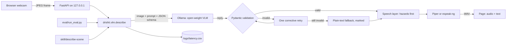

# DrishtiAI

An offline assistant that tells a blind or low-vision person what is in front of them.
A webcam frame goes to an open-weight vision-language model running on your own machine;
the answer comes back as validated JSON and is spoken aloud, **hazards first**, in English
or Hindi. No image, text or audio leaves the computer.

Built solo at Hacktoberfest Hack Day Hamirpur x ISTE NITH on 11 October 2026, for the
Best Open-Source AI Project track. *Drishti* (दृष्टि) is Hindi for sight.

> **Read this first.** DrishtiAI is an experimental aid. It can be wrong and it can miss
> hazards. It does not replace a cane, a guide dog or a human guide.

## 1. What it does

- **Surroundings**: describes the scene, warning about physical hazards before anything else.
- **Read**: reads visible text such as signs, labels and packaging.
- **Find**: you name an object; it answers found, not found or uncertain, with a rough location.
- Speaks the answer with an offline voice, in English or Hindi.
- Works from the keyboard alone, or by voice alone: say "describe", "read" or
  "find my bottle". Speech is recognised offline.

## 2. Problem and intended users

People with visual impairments often rely on phone apps that upload every photo to a
cloud service. That needs a data connection, costs money per request, and sends pictures
of homes, documents and medicines to someone else's server. DrishtiAI is for people who
want a description without any of that, and for developers who want a small, readable,
fully local reference pipeline to build on.

## 3. Why offline matters

- **Privacy**: camera frames can show faces, bank letters and prescriptions. Here they
  never leave the machine and are not saved to disk.
- **Availability**: it works with no signal, which is common in hostels, basements and
  rural areas.
- **Cost**: no API keys and no per-image charges.
- **Auditability**: the model weights are open, so anyone can reproduce an answer.

## 4. Features

- Strict JSON from the model, validated with Pydantic. An invalid answer is retried once
  with a correction, then replaced by a clearly marked plain-text fallback. Hazards are
  never invented to fill a gap.
- A speech layer that always says hazards first, nearest first, and only speaks objects
  or text in the mode that asks for them.
- Optional auto-monitoring (experimental) that only calls the model when the picture has
  changed, and does not repeat the same warning within 20 seconds.
- High-contrast page with large controls, visible focus, and states shown by text and
  symbols as well as colour. Each warning is a card with a direction arrow.
- An English / हिन्दी switch. Changing language re-words the answer on screen and speaks
  it again without calling the model.
- A latency log (CSV) with one row per model call.
- An evaluation script that reports missed hazards separately.
- An [Agent Skill](skill/describe-scene/SKILL.md) that exposes the same pipeline to
  coding agents.

## 5. Demo

Real output from `qwen3-vl:2b-instruct` running locally. To make these screenshots
repeatable, an evaluation photo was fed in as the webcam; nothing in them is mocked.

| Surroundings, English | Same answer after pressing **L** (Hindi) |
| --- | --- |
|  |  |


Photos in the screenshots: "Open Manhole - New Orleans September 2020" by Bart Everson
(CC BY 2.0) and "Wet floor caution sugn" by Kurt Kaiser (CC0), from Wikimedia Commons.

<!-- DEMO-GIF: record a short screen capture and save it as docs/demo.gif -->
*Demo recording: to be added.*

The live walk-through is scripted in [docs/demo.md](docs/demo.md).

## 6. Architecture



The app, the evaluation and the Agent Skill all call the one function
`drishti.vlm.describe()`.

| Path | Purpose |
| --- | --- |
| `drishti/vlm.py` | Ollama call, validation, retry, fallback |
| `drishti/schema.py` | The JSON schema and the API envelope |
| `drishti/speech.py` | What is spoken, in what order; repeat suppression |
| `drishti/tts.py` | Piper, then espeak-ng |
| `drishti/voice.py` | Offline voice commands (Whisper, or Vosk as a fallback) |
| `drishti/hindi.py` | The Hindi glossary |
| `drishti/server.py` | The API, bound to loopback |
| `prompts/` | Every prompt, loaded at run time |
| `web/` | The page: plain HTML, CSS and JavaScript |
| `eval/` | Evaluation script, labels, results |
| `skill/describe-scene/` | Agent Skill |
| `tests/` | Unit tests with the model and voice mocked |

## 7. Prerequisites

- Windows, Linux or macOS with a webcam. Developed on Windows 11.
- Python 3.11.
- [Ollama](https://ollama.com).
- About 4 GB of disk for Ollama's runtime, the model and the voices.
- A GPU helps a lot. Development hardware: NVIDIA RTX 4050 Laptop GPU (6 GB), 16 GB RAM.
- Node.js is only needed to run one optional test file.

## 8. Installation

```
git clone https://github.com/Dakshhhhh-ops/hacktober.git
cd hacktober
py -3.11 -m venv .venv
.venv\Scripts\python -m pip install -r requirements.txt
```

On Linux or macOS use `python3.11 -m venv .venv` and `.venv/bin/python`.

Optional: copy `.env.example` to `.env` to change the model, port or thresholds.

## 9. Download the model

```
ollama pull qwen3-vl:2b-instruct
```

## 10. Model and its licence

| | |
| --- | --- |
| Default model | `qwen3-vl:2b-instruct` on Ollama, which is Qwen3-VL-2B-Instruct |
| Do not use | the plain `qwen3-vl:2b` tag. It is the *thinking* variant; with this project's prompts it used its whole reply reasoning and returned no answer. The app reports this and tells you which model to pull. |
| Download size | 1.9 GB |
| Weights licence | Apache-2.0, as stated on the [model card](https://huggingface.co/Qwen/Qwen3-VL-2B-Instruct) |
| Why this one | It was the smallest image-capable model that fit the download time available on the day, and it runs in about 1.5 to 3 s per image on a 6 GB laptop GPU |

Any Ollama model that accepts images can be used by setting `OLLAMA_MODEL`, for example
`gemma3:4b` (3.4 GB, [Gemma Terms of Use](https://ai.google.dev/gemma/terms)). Only
`qwen3-vl:2b-instruct` has been tested and evaluated.

## 11. Install the voices

```
.venv\Scripts\python -m piper.download_voices en_US-lessac-medium hi_IN-pratham-medium --download-dir voices
```

This puts two files per voice in `voices/` (about 63 MB each). English and Hindi use
separate voices; the English voice is not used for Hindi. If a voice is missing, the page
says so and shows the text; it does not pretend to have spoken. If Piper is not installed
at all, `espeak-ng` is used when it is on the PATH.

## 12. Run

```
.venv\Scripts\python -m drishti
```

Open http://127.0.0.1:8000 and allow camera access. The server listens on this machine
only. The first description after starting is slower because the model is being loaded.

### Voice commands

For someone who cannot see the screen, typing and aiming at buttons are the hard part. Turn
voice on once (the **Voice commands** button, or **V**), then speak:

| Say | It does |
| --- | --- |
| "describe", "look around", "what is in front of me" | Surroundings mode, then describes |
| "read" | Read mode, then reads the text |
| "find my water bottle", "where is the door" | Find mode for that object |
| "find" | Asks "What are you looking for?" and waits for the object |
| "stop" | Stops the speech |
| "repeat" | Says the last answer again |
| "Hindi" / "English" | Switches language |

In Hindi mode Hindi commands work too, and the English ones keep working. Hindi
recognition with the small model is less reliable than English, especially for single
short words. In a test with synthesised speech these were recognised: बताओ (describe),
पढ़ो (read), "बोतल कहां है" (find), बस / "बंद करो" / "रुक जाओ" (stop), दोबारा (repeat)
and हिंदी. On their own, रुको and खोजो were sometimes missed.

Speech is recognised on your machine. The browser's own speech recognition is
deliberately not used, because it sends audio to a cloud service.

The recogniser is [Whisper](https://github.com/openai/whisper) (the `base` model, 142 MB,
through `faster-whisper`), running on the CPU. Download it once:

```
.venv\Scripts\python -c "from faster_whisper import WhisperModel; WhisperModel('base', device='cpu', compute_type='int8', download_root='models/whisper')"
```

At run time it is loaded with network access switched off. Whisper is open vocabulary, so
you can ask for any object ("find my blue backpack"), and it copes with natural sentences
and background noise. It takes about one second per command on the development laptop.

If Whisper is not installed, the app falls back to [Vosk](https://alphacephei.com/vosk/)
when its small models are unzipped into `models/`. Vosk is faster but only knows a fixed
list of about 150 words and was noticeably weaker with a real voice, which is why it was
replaced as the default.

Each language uses the recogniser that did better for it. For English that is Whisper.
For short Hindi commands the base Whisper model was worse than Vosk's word list (4 of 8
against 7 of 8), so Hindi tries Vosk first and Whisper second.

Measured with synthesised speech, ten English sentences at three noise levels: Whisper
understood 29 of 30, Vosk 23 of 30. That is clean test audio, not a study of real voices
in a real room. While the app is speaking it only listens for "stop".

### Use a phone as the camera

```
.venv\Scripts\python -m drishti --phone
```

The model still runs on the computer; the phone is only the camera, the screen and the
speaker. Nothing goes to the internet.

1. Put the phone and the computer on the same network. The phone's own hotspot works, and
   it does not need mobile data.
2. On the phone, open the `https://...:8443` address the command prints.
3. The browser warns that the certificate is not trusted. That is expected: phone browsers
   only allow the camera over HTTPS, so the command makes its own certificate on your
   computer. Choose Advanced (or Show Details), then proceed to the site.
4. Allow the camera, then tap the picture to describe. On phones that support it, the
   phone vibrates when there is a warning.

Phone mode listens on the whole local network with no login, so anyone on that network
can open the page while it is running. Prefer a private hotspot to public Wi-Fi and stop
it with Ctrl+C afterwards. It needs `openssl`, which Git for Windows includes. If the page
does not load, allow Python through the firewall when Windows asks.

## 13. Keyboard shortcuts

| Key | Action |
| --- | --- |
| Space | Describe what the camera sees now |
| 1 / 2 / 3 | Surroundings / Read / Find |
| L | Switch between English and Hindi (also the buttons at the top right) |
| A | Auto-monitor on or off (experimental) |
| V | Voice commands on or off |
| Esc | Stop speech |
| Enter (in the Find box) | Search for what you typed |

Shortcuts are off while you are typing in the Find box.

## 14. Evaluation

```
.venv\Scripts\python eval/run_eval.py
```

The set is 30 fixed images: 21 openly licensed photographs from Wikimedia Commons and 9
rendered text images. The label format, matching rules and metric definitions are in
[eval/README.md](eval/README.md). Results from the last run:

<!-- EVAL-RESULTS-START -->
Model `qwen3-vl:2b-instruct`, 30 images, run 2026-10-11 16:58.

**Missed hazards (false negatives): 1 of 15 labelled hazards.**

| Metric | Value |
| --- | --- |
| Images evaluated | 30 (18 scored for hazards, 15 for reading) |
| Failed inferences | 0 |
| Plain-text fallbacks (no validated JSON) | 0 |
| Hazard recall | 93% (14 of 15) |
| **Missed hazards** | **1** |
| False alarms | 6 (0.33 per image) |
| False-alarm rate (false alarms / all hazards the model reported) | 21% (6 of 29) |
| Hazard-free images that still got a warning | 3 of 4 |
| Text read correctly (similarity >= 80%) | 14 of 15 |
| Mean text similarity | 0.975 |
| Median model latency | 1499 ms |
| p95 model latency | 2454 ms (33 inferences) |

Missed hazards, by image:

- `trip_hazard_pavement.jpg`: uneven pavement

### What changed between the first run and this one

The first real run used the prompt exactly as first written. The model repeated the
example hazards from the system prompt ("stairs, open door, wet floor, moving people")
on almost every image, including empty corridors. The fix was to make it list what it
sees first, choose hazards only from that list, and to say that the examples are not a
checklist. Both runs are real and both result files are in the repository.

| | First run ([baseline](eval/baseline/results.md)) | Current |
| --- | --- | --- |
| Hazards found | 9 of 15 | 14 of 15 |
| **Missed hazards** | **6** | **1** |
| False alarms | 31 | 6 |
| Hazard-free images that still got a warning | 4 of 4 | 3 of 4 |
| Plain-text fallbacks | 3 | 0 |
| Text read correctly | 14 of 15 | 14 of 15 |
| Median model latency | 2904 ms | 1499 ms |

### How to read these numbers

- **They are optimistic.** The prompt was tuned on these same 30 images, and there is no
  separate held-out set. Expect worse on new scenes.
- **False alarms are still common on clear scenes**: 3 of 4 hazard-free images got a warning
  (a door, a floor, an exit sign). Four images is far too few to estimate a rate.
- The photographs were chosen because they show a hazard clearly, in daylight.
- Latency was measured on an RTX 4050 Laptop GPU (6 GB) with the model already loaded.
<!-- EVAL-RESULTS-END -->

## 15. Tests

```
.venv\Scripts\python -m unittest discover -s tests -t .
node --test tests/gate.test.mjs tests/voice.test.mjs
```

The unit tests mock Ollama, the voice engine and the speech recogniser, so they need no model and play no audio.
They cover JSON parsing, retry and fallback, invalid enum values and field types,
hazard-first speech, mode filtering, the find result, repeat suppression, the latency
log, API errors, the evaluation metrics and frame-change gating.

To check the real model end to end (needs Ollama running; slow, and not mocked):

```
.venv\Scripts\python tests/integration_check.py
```

It sends a rendered EXIT sign through the pipeline in Read and Surroundings modes, checks
that valid JSON came back and the sign was read, and prints the measured latency.

## 16. Agent Skill

[skill/describe-scene](skill/describe-scene/SKILL.md) follows the
[Agent Skills](https://agentskills.io) open standard. Its script takes an image path and
prints the same validated JSON:

```
.venv\Scripts\python skill/describe-scene/scripts/describe.py photo.jpg --mode find --target "keys"
```

If the model cannot be reached it exits with an error and says the image was not
inspected.

## 17. Assumptions

- One user on one machine. There is no login and no database.
- The camera points where the person is facing, so "left" and "right" are relative to it.
- Distance words (near, mid, far) are rough visual judgements from one camera. Nothing is
  measured.
- A summary longer than 25 words is cut short when spoken so it cannot delay a warning.
- The model is always asked to answer in English, including in Hindi mode. Hindi wording
  comes from a fixed glossary in `drishti/hindi.py` (see the limitations).

## 18. Known limitations

<!-- LIMITATIONS-MEASURED -->
- **It can invent or miss things.** A 2-billion-parameter model hallucinates. In the
  evaluation it still warned on most hazard-free scenes and missed uneven paving. See
  section 14.
- **Latency.** Measured on the development laptop: about 1.5 to 3 s inside the model, then
  1 to 3 s to synthesise the speech on the CPU. The warning is synthesised first so it
  starts as early as possible, but this is far too slow for anything moving quickly.
  The first request after starting is slower because the model has to load.
- **Auto-monitor is not continuous detection.** It skips frames that look similar, and a
  small change in the picture can still be a new hazard.
- **Small or curved text** is often misread. Medicine names and doses must be checked by
  another means.
- **Hindi is glossary-based.** The 2B model cannot write usable Hindi: asked to, it
  returned broken JSON, and its translations of short phrases were mostly nonsense. So
  Hindi warnings are built from a fixed glossary of about 100 common words. Adjectives
  are dropped ("red plastic barriers" becomes "बैरिकेड"), a word that is not in the
  glossary is spoken in English, and the scene line is a list of recognised objects
  where English mode gives a sentence. Text read in Read mode is never translated.
  Hindi output has been checked by reading it, not formally evaluated.
- **Voice commands add about a second**, and recognition has only been tested with
  synthesised speech, not measured with real voices in a noisy room.
- **Speech volume** is controlled in the page, and speech rate is fixed.

## 19. Safety disclaimer

DrishtiAI is a research prototype built in one day. Do not use it as your only source of
information when moving around, crossing roads, using stairs or taking medicine. When it
reports no hazards, that means only that the model did not report any. It does not replace
a cane, a guide dog or a human guide.

## 20. Offline check

Internet is needed once, to install Ollama, the Python packages, the model and the voices.
After that:

1. Turn off Wi-Fi and unplug the network cable.
2. Start Ollama and run `python -m drishti`.
3. Open http://127.0.0.1:8000, press Space, and confirm you hear a description.
4. Open the browser's developer tools, Network tab: every request goes to `127.0.0.1`.

The page loads no remote fonts, scripts or analytics, and is marked so that browsers do
not offer to translate it through a cloud service.

<!-- OFFLINE-VERIFIED -->
*Offline run on the development machine: not yet verified.*

## Licences

- **This project's code**: MIT. See [LICENSE](LICENSE).
- **Model weights** (`qwen3-vl:2b-instruct`): Apache-2.0. Not included in this repository.
- **Ollama**: MIT.
- **Piper** (`piper-tts`): GPL-3.0-or-later. It is a separate program that this project
  calls as an optional dependency; it is not included in this repository. If you
  redistribute DrishtiAI together with Piper, check what the GPL requires of the
  combination.
- **Voices**, not included in this repository:
  - `en_US-lessac-medium`: trained on the Blizzard 2013 Lessac dataset, under
    [its own licence](https://www.cstr.ed.ac.uk/projects/blizzard/2013/lessac_blizzard2013/license.html).
  - `hi_IN-pratham-medium`: its model card lists
    [CC BY-NC-SA 4.0](http://creativecommons.org/licenses/by-nc-sa/4.0/), which does not
    allow commercial use.
- **Whisper** model weights and **faster-whisper**: MIT. **Vosk** (fallback): Apache-2.0.
  Speech models are downloaded separately and are not included here; each Vosk model's
  licence is listed on the [Vosk models page](https://alphacephei.com/vosk/models).
- **FastAPI** and **Pydantic**: MIT. **Uvicorn**: BSD-3-Clause.
- **Evaluation photographs** in `eval/images/`: from Wikimedia Commons under CC0, CC BY,
  CC BY-SA or public domain. Authors and licences are in [eval/SOURCES.md](eval/SOURCES.md).

This is a description of the licences as published, not legal advice.

## Contributing

Issues and pull requests are welcome. Please run both test commands in section 15 before
opening a pull request, keep modules small, and do not add a dependency without saying
why it is needed. Changes that affect what is spoken should come with a test in
`tests/test_speech.py`.

## How it was built

Built during the hack day by Daksh ([@Dakshhhhh-ops](https://github.com/Dakshhhhh-ops)).
Tools: Python, FastAPI, Pydantic, Ollama, Qwen3-VL, Piper.
