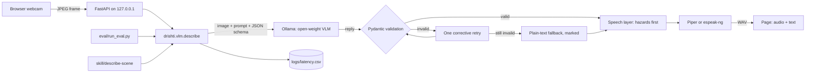

# DrishtiAI

An offline assistant that tells a blind or low-vision person what is in front of them.
A webcam frame goes to an open-weight vision-language model running on your own machine;
the answer comes back as validated JSON and is spoken aloud, **hazards first**, in English
or Hindi. No image, text or audio leaves the computer.

Built solo at Hacktoberfest Hack Day Hamirpur x ISTE NITH on 11 October 2026, for the
Best Open-Source AI Project track. *Drishti* (दृष्टि) is Hindi for sight.

> **Read this first.** DrishtiAI is an experimental aid. It can be wrong and it can miss
> hazards. It does not replace a cane, a guide dog or a human guide.

## 1. What it does

- **Surroundings**: describes the scene, warning about physical hazards before anything else.
- **Read**: reads visible text such as signs, labels and packaging.
- **Find**: you name an object; it answers found, not found or uncertain, with a rough location.
- Speaks the answer with an offline voice, in English or Hindi.
- Works from the keyboard alone. Space describes what the camera sees now.

## 2. Problem and intended users

People with visual impairments often rely on phone apps that upload every photo to a
cloud service. That needs a data connection, costs money per request, and sends pictures
of homes, documents and medicines to someone else's server. DrishtiAI is for people who
want a description without any of that, and for developers who want a small, readable,
fully local reference pipeline to build on.

## 3. Why offline matters

- **Privacy**: camera frames can show faces, bank letters and prescriptions. Here they
  never leave the machine and are not saved to disk.
- **Availability**: it works with no signal, which is common in hostels, basements and
  rural areas.
- **Cost**: no API keys and no per-image charges.
- **Auditability**: the model weights are open, so anyone can reproduce an answer.

## 4. Features

- Strict JSON from the model, validated with Pydantic. An invalid answer is retried once
  with a correction, then replaced by a clearly marked plain-text fallback. Hazards are
  never invented to fill a gap.
- A speech layer that always says hazards first, nearest first, and only speaks objects
  or text in the mode that asks for them.
- Optional auto-monitoring (experimental) that only calls the model when the picture has
  changed, and does not repeat the same warning within 20 seconds.
- High-contrast page with large controls, visible focus, and states shown by text and
  symbols as well as colour.
- A latency log (CSV) with one row per model call.
- An evaluation script that reports missed hazards separately.
- An [Agent Skill](skill/describe-scene/SKILL.md) that exposes the same pipeline to
  coding agents.

## 5. Demo

<!-- DEMO-GIF: record a short screen capture and save it as docs/demo.gif -->
*Demo recording: to be added.*

## 6. Architecture



The app, the evaluation and the Agent Skill all call the one function
`drishti.vlm.describe()`.

| Path | Purpose |
| --- | --- |
| `drishti/vlm.py` | Ollama call, validation, retry, fallback |
| `drishti/schema.py` | The JSON schema and the API envelope |
| `drishti/speech.py` | What is spoken, in what order; repeat suppression |
| `drishti/tts.py` | Piper, then espeak-ng |
| `drishti/server.py` | The API, bound to loopback |
| `prompts/` | Every prompt, loaded at run time |
| `web/` | The page: plain HTML, CSS and JavaScript |
| `eval/` | Evaluation script, labels, results |
| `skill/describe-scene/` | Agent Skill |
| `tests/` | Unit tests with the model and voice mocked |

## 7. Prerequisites

- Windows, Linux or macOS with a webcam. Developed on Windows 11.
- Python 3.11.
- [Ollama](https://ollama.com).
- About 4 GB of disk for Ollama's runtime, the model and the voices.
- A GPU helps a lot. Development hardware: NVIDIA RTX 4050 Laptop GPU (6 GB), 16 GB RAM.
- Node.js is only needed to run one optional test file.

## 8. Installation

```
git clone https://github.com/Dakshhhhh-ops/hacktober.git
cd hacktober
py -3.11 -m venv .venv
.venv\Scripts\python -m pip install -r requirements.txt
```

On Linux or macOS use `python3.11 -m venv .venv` and `.venv/bin/python`.

Optional: copy `.env.example` to `.env` to change the model, port or thresholds.

## 9. Download the model

```
ollama pull qwen3-vl:2b
```

## 10. Model and its licence

| | |
| --- | --- |
| Default model | `qwen3-vl:2b` on Ollama, which is Qwen3-VL-2B-Instruct |
| Download size | 1.9 GB |
| Weights licence | Apache-2.0, as stated on the [model card](https://huggingface.co/Qwen/Qwen3-VL-2B-Instruct) |
| Why this one | It was the smallest image-capable model that fit the download time available on the day |

Any Ollama model that accepts images can be used by setting `OLLAMA_MODEL`, for example
`gemma3:4b` (3.4 GB, [Gemma Terms of Use](https://ai.google.dev/gemma/terms)). Only
`qwen3-vl:2b` has been tested.

## 11. Install the voices

```
.venv\Scripts\python -m piper.download_voices en_US-lessac-medium hi_IN-pratham-medium --download-dir voices
```

This puts two files per voice in `voices/` (about 63 MB each). English and Hindi use
separate voices; the English voice is not used for Hindi. If a voice is missing, the page
says so and shows the text; it does not pretend to have spoken. If Piper is not installed
at all, `espeak-ng` is used when it is on the PATH.

## 12. Run

```
.venv\Scripts\python -m drishti
```

Open http://127.0.0.1:8000 and allow camera access. The server listens on this machine
only. The first description after starting is slower because the model is being loaded.

## 13. Keyboard shortcuts

| Key | Action |
| --- | --- |
| Space | Describe what the camera sees now |
| 1 / 2 / 3 | Surroundings / Read / Find |
| L | Switch between English and Hindi |
| A | Auto-monitor on or off (experimental) |
| Esc | Stop speech |
| Enter (in the Find box) | Search for what you typed |

Shortcuts are off while you are typing in the Find box.

## 14. Evaluation

```
.venv\Scripts\python eval/run_eval.py
```

The label format, matching rules and metric definitions are in
[eval/README.md](eval/README.md). Results from the last run:

<!-- EVAL-RESULTS-START -->
*No evaluation has been run yet. This section is filled from `eval/results.md`.*
<!-- EVAL-RESULTS-END -->

## 15. Tests

```
.venv\Scripts\python -m unittest discover -s tests -t .
node --test tests/gate.test.mjs
```

The unit tests mock Ollama and the voice engine, so they need no model and play no audio.
They cover JSON parsing, retry and fallback, invalid enum values and field types,
hazard-first speech, mode filtering, the find result, repeat suppression, the latency
log, API errors, the evaluation metrics and frame-change gating.

To check the real model end to end (needs Ollama running; slow, and not mocked):

```
.venv\Scripts\python tests/integration_check.py
```

It sends a rendered EXIT sign through the pipeline in Read and Surroundings modes, checks
that valid JSON came back and the sign was read, and prints the measured latency.

## 16. Agent Skill

[skill/describe-scene](skill/describe-scene/SKILL.md) follows the
[Agent Skills](https://agentskills.io) open standard. Its script takes an image path and
prints the same validated JSON:

```
.venv\Scripts\python skill/describe-scene/scripts/describe.py photo.jpg --mode find --target "keys"
```

If the model cannot be reached it exits with an error and says the image was not
inspected.

## 17. Assumptions

- One user on one machine. There is no login and no database.
- The camera points where the person is facing, so "left" and "right" are relative to it.
- Distance words (near, mid, far) are rough visual judgements from one camera. Nothing is
  measured.
- A summary longer than 25 words is cut short when spoken so it cannot delay a warning.
- In Hindi mode the model is asked to answer in Hindi; fixed words such as directions are
  translated by the app.

## 18. Known limitations

<!-- LIMITATIONS-MEASURED -->
- **It can invent or miss things.** A 2-billion-parameter model hallucinates. See the
  missed-hazard count in the evaluation.
- **Latency.** Each description takes seconds, not milliseconds, so it cannot warn about
  something moving quickly.
- **Auto-monitor is not continuous detection.** It skips frames that look similar, and a
  small change in the picture can still be a new hazard.
- **Small or curved text** is often misread. Medicine names and doses must be checked by
  another means.
- **Hindi quality** depends on the model and has not been formally evaluated.
- **Find by voice** is not implemented; the object name is typed.
- **Speech volume** is controlled in the page, and speech rate is fixed.

## 19. Safety disclaimer

DrishtiAI is a research prototype built in one day. Do not use it as your only source of
information when moving around, crossing roads, using stairs or taking medicine. When it
reports no hazards, that means only that the model did not report any. It does not replace
a cane, a guide dog or a human guide.

## 20. Offline check

Internet is needed once, to install Ollama, the Python packages, the model and the voices.
After that:

1. Turn off Wi-Fi and unplug the network cable.
2. Start Ollama and run `python -m drishti`.
3. Open http://127.0.0.1:8000, press Space, and confirm you hear a description.
4. Open the browser's developer tools, Network tab: every request goes to `127.0.0.1`.

The page loads no remote fonts, scripts or analytics, and is marked so that browsers do
not offer to translate it through a cloud service.

<!-- OFFLINE-VERIFIED -->
*Offline run on the development machine: not yet verified.*

## Licences

- **This project's code**: MIT. See [LICENSE](LICENSE).
- **Model weights** (`qwen3-vl:2b`): Apache-2.0. Not included in this repository.
- **Ollama**: MIT.
- **Piper** (`piper-tts`): GPL-3.0-or-later. It is a separate program that this project
  calls as an optional dependency; it is not included in this repository. If you
  redistribute DrishtiAI together with Piper, check what the GPL requires of the
  combination.
- **Voices**, not included in this repository:
  - `en_US-lessac-medium`: trained on the Blizzard 2013 Lessac dataset, under
    [its own licence](https://www.cstr.ed.ac.uk/projects/blizzard/2013/lessac_blizzard2013/license.html).
  - `hi_IN-pratham-medium`: its model card lists
    [CC BY-NC-SA 4.0](http://creativecommons.org/licenses/by-nc-sa/4.0/), which does not
    allow commercial use.
- **FastAPI** and **Pydantic**: MIT. **Uvicorn**: BSD-3-Clause.

This is a description of the licences as published, not legal advice.

## Contributing

Issues and pull requests are welcome. Please run both test commands in section 15 before
opening a pull request, keep modules small, and do not add a dependency without saying
why it is needed. Changes that affect what is spoken should come with a test in
`tests/test_speech.py`.

## How it was built

Built during the hack day by Daksh ([@Dakshhhhh-ops](https://github.com/Dakshhhhh-ops)).
Tools: Python, FastAPI, Pydantic, Ollama, Qwen3-VL, Piper.
