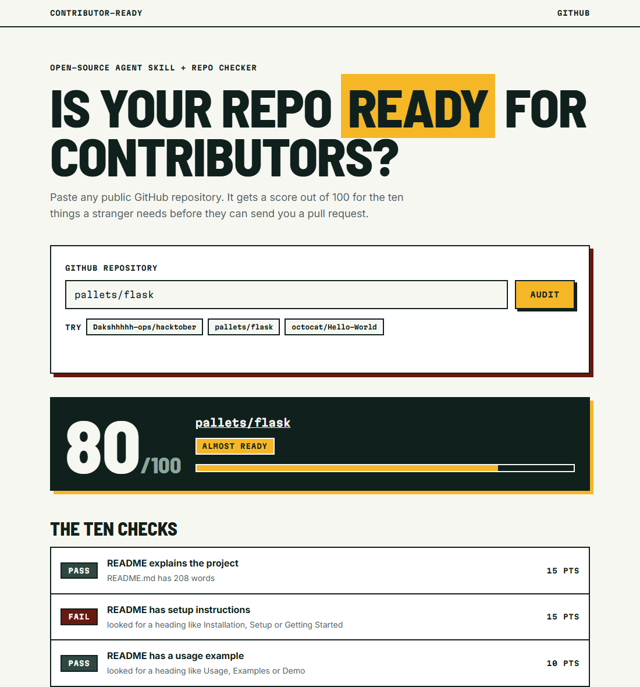

# contributor-ready

An agent skill that audits a repository for how ready it is to receive outside
contributions, scores it out of 100, and drafts the files that are missing. It comes
with a web page that scores any public GitHub repository in the browser.



Built for the **Best Open-Source AI Project** track at Hacktoberfest Hack Day
Hamirpur x ISTE NITH (11 October 2026).

## The problem

Most student and hobby repositories get no contributors, and it is rarely because of the
code. A stranger opens the repo and finds no setup steps, no license, and no hint of how
to send a change. During Hacktoberfest this is the gap between a project that gets pull
requests and one that gets ignored.

## What it does

`contributor-ready` follows the [Agent Skills open standard](https://agentskills.io), so
any compatible agent can load it. When activated, the agent:

1. Runs `scripts/audit.py`, which checks ten things a new contributor needs.
2. Reports a score and the failing checks, biggest win first.
3. Reads the repository to find the real install, run and test commands, then drafts the
   missing files from the templates in `assets/`.
4. Runs the audit again and shows the score before and after.

| Check | Points |
| --- | --- |
| Open-source license | 20 |
| README explains the project | 15 |
| README has setup instructions | 15 |
| CONTRIBUTING guide | 15 |
| README has a usage example | 10 |
| Code of conduct | 5 |
| Issue template | 5 |
| Pull request template | 5 |
| Continuous integration | 5 |
| .gitignore | 5 |

## Setup

You need Python 3.8 or newer. There are no dependencies to install.

```
git clone https://github.com/Dakshhhhh-ops/hacktober.git
```

To use it as a skill, copy the `contributor-ready` folder into your agent's skills
directory. For Claude Code that is `.claude/skills/` in a project or `~/.claude/skills/`
for every project:

```
cp -r hacktober/contributor-ready ~/.claude/skills/
```

## Usage

### In the browser

Open `docs/index.html` in a browser, or use the hosted copy at
https://dakshhhhh-ops.github.io/hacktober/. Type a repository as `owner/name` or paste
its GitHub URL and press Audit. Add `?repo=owner/name` to the address to link straight
to a result.

The page runs the same ten checks as the skill, using GitHub's public API. Nothing is
installed and no login is needed. GitHub allows about 30 audits an hour per network
without a login.

### With an agent

With an agent, open any repository and ask:

> Make this repo ready for Hacktoberfest contributors.

Without an agent, run the audit on its own:

```
python contributor-ready/scripts/audit.py path/to/repo
python contributor-ready/scripts/audit.py path/to/repo --json
```

Example output:

```
Contributor readiness: 20/100 (not ready)

  [FAIL] README explains the project (15 pts) - README.md has 2 words
  [PASS] Open-source license (20 pts) - LICENSE
  [FAIL] CONTRIBUTING guide (15 pts) - no CONTRIBUTING file found

Fix next, biggest win first:
  +15  Write a README of at least a few paragraphs: what it does and who it is for.
  +15  Add CONTRIBUTING.md from assets/CONTRIBUTING.md.
```

## Project layout

```
contributor-ready/
  SKILL.md                      instructions the agent follows
  scripts/audit.py              the audit, standard library only
  assets/CONTRIBUTING.md        template
  assets/PULL_REQUEST_TEMPLATE.md
  assets/bug_report.md
docs/
  index.html                    the web checker
  audit.js                      the same checks, ported to the browser
```

## Team and tools

- Daksh ([@Dakshhhhh-ops](https://github.com/Dakshhhhh-ops)): idea, direction, testing
  and submission.
- Tools: Python 3 standard library, plain HTML, CSS and JavaScript, the GitHub REST API,
  Google Fonts, the Agent Skills specification, and Claude Code as
  the AI coding assistant that wrote the code during the event.

## License

MIT. See [LICENSE](LICENSE).
